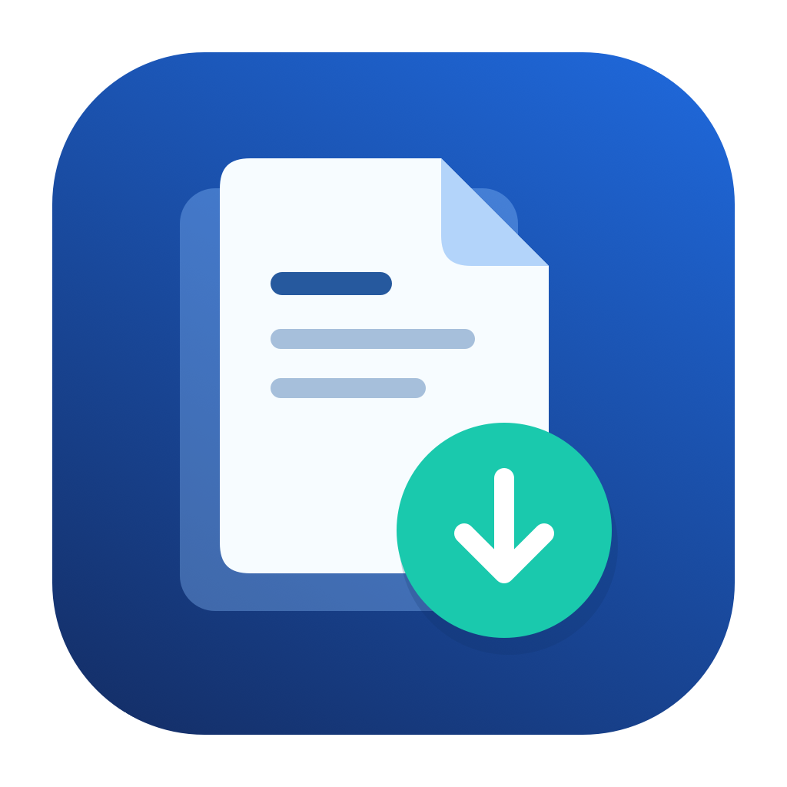

# 网页保存与整理



一个 macOS 桌面工具：收集网页链接，用本机 Chrome 保存 MHTML，再将已保存的 HTML/MHTML 整理为 TXT。所有规则处理在本地完成，无需 AI 服务、登录本工具账号或填写 API Key。

## 文件说明与安装

下载整个仓库并解压后，安装包就在最外层。

| 文件或文件夹 | 用途 |
| --- | --- |
| [WebArchive-1.0.1-macOS-universal2.dmg](WebArchive-1.0.1-macOS-universal2.dmg?raw=true) | macOS 完整安装包（22.5 MB），普通用户双击这个文件安装 |
| README.md | 使用说明，就是当前这份文档 |
| src/ | 程序源代码，供修改程序使用 |
| assets/ | 图标和图标绘制源文件 |
| docs/ | 安装说明、第三方许可和验证记录 |
| scripts/、WebArchive.spec、requirements-build.txt | 重新打包 App 所用的脚本和配置 |
| tests/ | 功能检查脚本 |
| VERSION | 程序版本号 |
| SHA256SUMS.txt | 安装包校验值，用于检查文件是否完整 |

双击最外层的 DMG，将“网页保存与整理”拖入“应用程序”，然后双击 App 启动。无需安装 Python 或输入命令。

- 已内置 Python 和 Tcl/Tk，无需单独安装运行库，也不需要打开终端。
- 收集链接、保存网页需要 **Google Chrome**；本地 TXT 整理可以离线运行。
- App 为 universal2 构建，包含 Apple Silicon 与 Intel 代码。目标系统 macOS 11+；本次在 Apple Silicon 主机验证，旧系统及 Intel 实机尚待验证。
- 当前未完成 Developer ID 签名与 Apple 公证。下载后首次启动可能被系统拦截；参见 [Apple 官方说明](https://support.apple.com/zh-cn/102445)。正式面向大众发布前，建议签名、公证；不要求关闭全局安全检查。

## 使用流程

1. 粘贴目录或章节网址，点“自动收集目录 / 分页链接”。
2. 查看并编辑收集结果，点“使用这份清单 → 主窗口”。
3. 如需登录目标网站，点“① 打开浏览器 / 先登录”。
4. 点“② 开始批量保存”，保存完成后点“③ 整理已保存网页 → 合并 TXT”。
5. 已有本地网页时可直接从第 4 步的整理入口开始。

### 链接收集

默认识别 `/book/书号/章节.html`、`/view/数字.html`、`/chapter/`、`/read/` 等路径。

- 输入章节网址：从当前章节沿明确的“下一章／下一节”链接继续收集，并检查每章内部的数字分页；不会自动补齐入口之前的章节。
- 输入目录网址：跟进目录的同系列分页及章内分页，保持目录原有顺序。
- 去除重复网址和末章循环链接；`/book/书号/章节.html` 的下一章检查限定在同一书号内。
- 网页 DOM 可读后等待链接稳定，不必等广告图片等全部资源加载完。
- 未识别到章节时显示未完成；“查看检查详情”可以查看失败网址、原因和未检查页面。

其他网址形式可填写正文匹配正则或目录链接 CSS 选择器。这仍是规则处理，不会自动理解所有网站；纯 JavaScript 目录按钮、特殊分页结构仍可能需要适配。

仅访问入口同站点上实际出现的链接，不猜造网址、不绕过登录或验证码。默认上限 500 页，失败、停止、达到上限均会显示未完成。按钮分页、无限滚动、特殊网址和推荐区混杂等情况可能需要调整规则；请审阅清单。“完成”只代表规则范围内的检查完成，并非通用于所有网站。

### 本地正文整理

- 优先沿用原目录；同人和番外保留原位置，区分第一部与第二部。
- 合并已保存的章内分页，检测可识别的缺页；首页 `_1.html` 别名去重。
- 修复网页硬折行、明确的角引号断行及跨页对话。
- 精确删除独立的“本章未完，点击数字分页继续阅读”提示；不按泛关键词删除正文。
- 原文引号配对、方向等疑点列入报告，不猜测修改标点。
- 缺少目录页时，可选择旧版 `提取校验.json` 恢复原顺序。
- 校验清理指定提示后正文的非空白字符一致性，输出 UTF-8 BOM TXT。

每次结果另存时间文件夹，原网页及旧结果保留。复杂表格、代码排版、图片文字不属于自动正文整理的适用范围。

## 数据位置

安装版默认输出到 `~/Documents/网页保存与整理/已保存网页`。设置、专用浏览器登录资料和启动日志位于 `~/Library/Application Support/WebArchive`。保存目录可以在界面选择并记住。

源码运行时，默认使用 `src` 目录内的“浏览器数据”和“已保存网页”。这些文件均应保持在 Git 之外。发行包仅包含程序和运行库，不含任何个人网页、正文、Cookie 或历史日志。

## 源码运行与构建

源码需要 macOS、带 Tk 的 Python 3.13；网页功能另需 Chrome。

```sh
python3 src/网页批量保存.py
PYTHONPATH=src python3 tests/整理功能自检.py
PYTHONPATH=src python3 tests/链接收集自检.py
PYTHONPATH=src python3 tests/链接收集自检.py --browser
```

构建安装包：

```sh
python3 -m venv .venv
.venv/bin/python -m pip install -r requirements-build.txt
.venv/bin/python scripts/build_macos.py
```

默认生成 `release/WebArchive-1.0.1-macOS-universal2.dmg` 和 SHA-256 校验值。universal2 要求 Python、Tk 及全部二进制依赖同时包含 arm64 和 x86_64；也可传 `--arch arm64` 或 `--arch x86_64`，并相应调整发行说明。版本号位于 `VERSION`。

可用 `python3 scripts/verify_bundle.py /path/to/网页保存与整理.app` 验证搬移后的安装包。测试使用临时目录及本机 HTTP 页面，覆盖界面启动、TXT 后处理和真实 Chrome 归档，不读取个人网页。

图标的可编辑绘图程序在 `assets/draw_icon.swift`。重新生成：

```sh
swift assets/draw_icon.swift assets
iconutil -c icns assets/AppIcon.iconset -o assets/AppIcon.icns
```

## 上传到 GitHub

将本目录里的全部文件上传到仓库根目录即可，包含最外层的 DMG 安装包。别人通过“Code → Download ZIP”下载并解压后，直接打开最外层的 DMG 安装。

更新程序时，同步替换最外层的安装包、SHA256SUMS.txt 和本说明中的文件名。

不要上传日常使用的“批量网页保存工具”文件夹，其中包含个人网页和浏览器数据。本目录是专门准备的发布目录。

目前未选定本项目的开源授权协议；在声明为开源项目之前应由作者选择许可证。运行库许可见 `docs/THIRD_PARTY_NOTICES.txt`。
